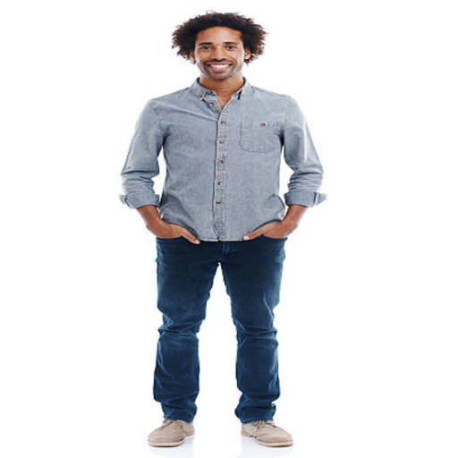
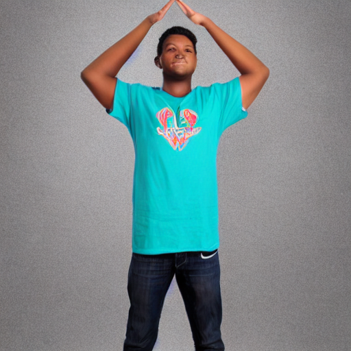
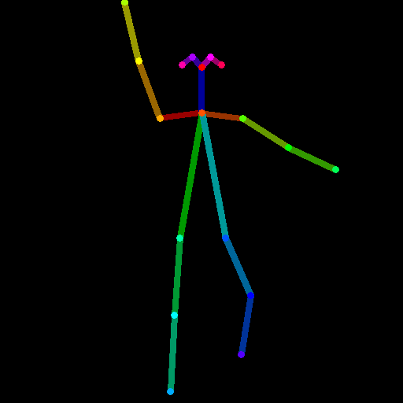
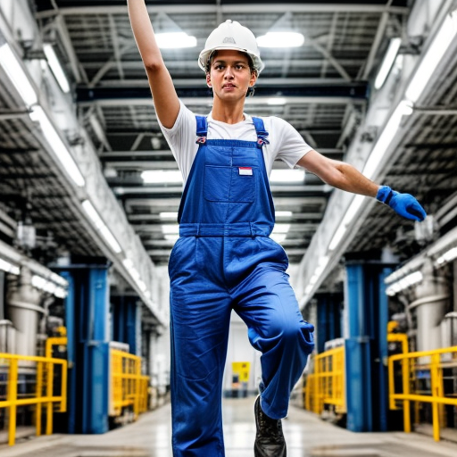
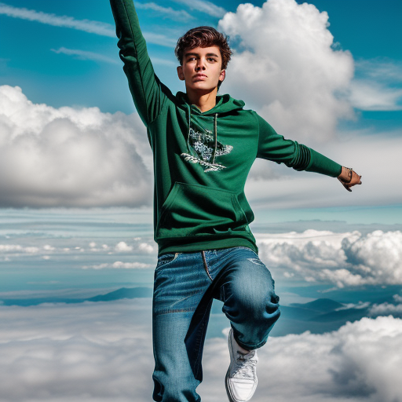
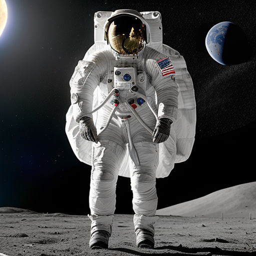
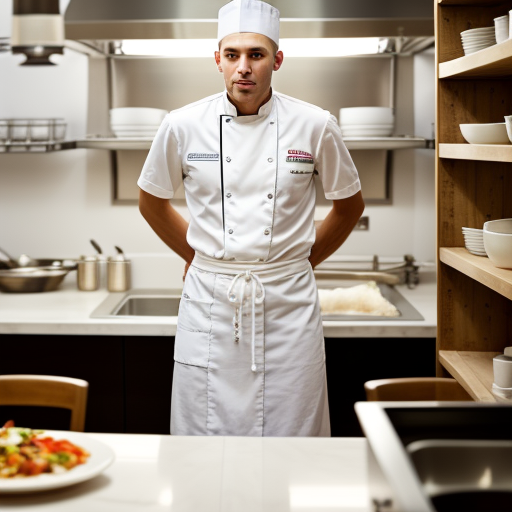
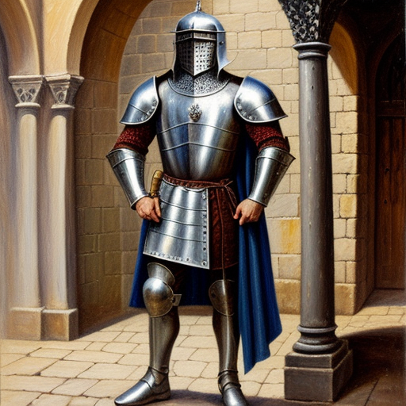
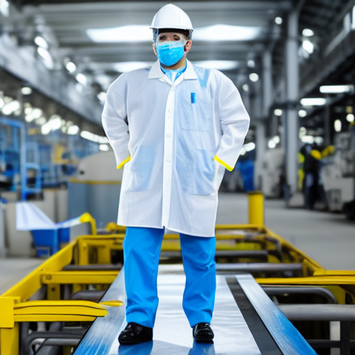
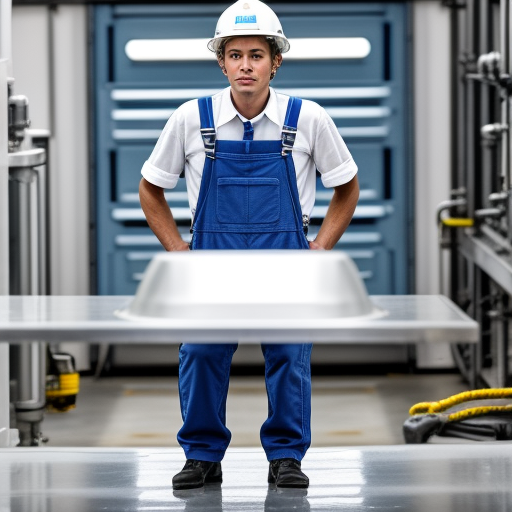

# 원하는 포즈로 이미지 만드는 도구

참조 사진 속 사람의 자세(관절 위치)를 OpenPose로 뽑아, 그 자세 그대로 프롬프트가 묘사하는 새 인물을 그리는 Colab 튜토리얼입니다.

```
참조 사진 → OpenPose 뼈대 추출 → 뼈대 + 프롬프트 → 같은 자세의 새 이미지
```

## 도구 설명
- 포즈 추출: `controlnet_aux` 의 OpenposeDetector
- 이미지 생성: Stable Diffusion 1.5 + ControlNet v1.1 OpenPose (`diffusers`)
- 실행 환경: Google Colab 무료 T4 GPU (한 장에 약 4초)
- 출발점은 교안의 FLUX.2-klein 4B Colab 노트였지만, FLUX.2에는 공식 OpenPose ControlNet이 없어 무료 T4에서 안정적으로 동작하는 SD 1.5 조합으로 포즈 조건을 구현했습니다.

## 사용법
1. [pose_tool.ipynb를 Colab에서 열기](https://colab.research.google.com/github/gsahn26/pose-image-tool/blob/main/pose_tool.ipynb)
2. 런타임 → 런타임 유형 변경 → **T4 GPU** 를 선택합니다.
3. **모두 실행**을 누릅니다. 기본값은 예시 사진으로 끝까지 돌아가고, 내 사진을 쓰려면 셀 3의 `USE_UPLOAD = True` 로 바꿉니다.
4. 결과는 `samples/` 에 저장되고, 마지막 코드 셀에서 zip과 `prompts.md` 를 내려받습니다.

## 폴더 구조
```
pose-image-tool/
├── README.md        # 도구 설명, 사용법, 결과
├── pose_tool.ipynb  # Colab 튜토리얼 노트 (실행 결과 포함)
├── samples/         # 참조 사진, 뼈대, 결과 이미지
└── prompts.md       # 테스트에 쓴 프롬프트
```

## 테스트 결과

프롬프트: `a factory worker in a white safety helmet and blue overalls, inside a bright manufacturing plant, photorealistic documentary photography` (시드 42, 20스텝)

| 참조 사진 | 뽑아낸 포즈 | 결과 |
|---|---|---|
|  |  |  |
|  |  |  |
| (사진 없음, 좌표로 직접 그림) |  |  |

- 포즈 1: 손을 주머니에 넣고 선 자세 → 결과도 흰 가운 주머니에 손을 넣고 같은 자세로 섰습니다.
- 포즈 2: 두 손을 머리 위로 올린 자세 → 팔꿈치를 벌리고 손을 머리 위로 올린 모양이 그대로 나왔습니다. 다만 손은 안전모를 붙잡는 모양으로 바뀌었습니다.
- 포즈 3: 하늘을 나는 자세(한 팔은 하늘로, 한 팔은 옆으로, 한쪽 무릎 굽힘) → 자세는 그대로 나왔지만, 배경이 공장이라 나는 게 아니라 춤추는 것처럼 보였습니다.

### 포즈 3 — 하늘을 나는 자세
따라 할 사진이 없어서 OpenPose 관절 18개의 좌표를 숫자로 정해 뼈대를 직접 그렸습니다(노트의 셀 9-2).

| 직접 그린 뼈대 | 공장 작업자 프롬프트 | 하늘 프롬프트 |
|---|---|---|
|  |  |  |

하늘 프롬프트: `a young man in a green hoodie and jeans flying high in the bright blue sky above white clouds, one arm reaching up to the sky, wind in his hair, full body, photorealistic` (시드 7)

같은 뼈대라도 배경을 하늘·구름으로 적어야 '나는 장면'이 됩니다. 처음 쓴 "superhero in a red cape" 프롬프트는 유명 만화 캐릭터와 거의 같은 그림이 나와서 평범한 인물로 바꿨습니다.

### 같은 포즈, 다른 프롬프트 (실험 A)
| 우주비행사 | 요리사 | 기사(유화) |
|---|---|---|
|  |  |  |

자세는 그대로이고 옷·배경·분위기만 바뀌었습니다. 프롬프트에 없던 칼(기사)과 음식 접시(요리사)가 생겼습니다.

### 조건 세기 비교 (0.5 / 1.0 / 1.5)
| 0.5 | 1.0 | 1.5 |
|---|---|---|
|  |  |  |

## 한계
- 손과 손가락이 자주 뭉개집니다.
- 프롬프트에 적지 않은 것(마스크, 소품)은 모델이 마음대로 채웁니다.
- SD 1.5라서 기본 해상도가 512×512입니다.

## 참조 사진 출처와 라이선스
- ref_01: Hugging Face `documentation-images` 데이터셋의 예시 사진(person.png)
- ref_02: 실존 인물 사진을 쓰지 않으려고 SD 1.5로 직접 생성한 사진
- pose_03: 사진 없이 관절 좌표로 직접 그린 뼈대
- Stable Diffusion 1.5: CreativeML OpenRAIL-M / ControlNet v1.1 OpenPose: OpenRAIL
