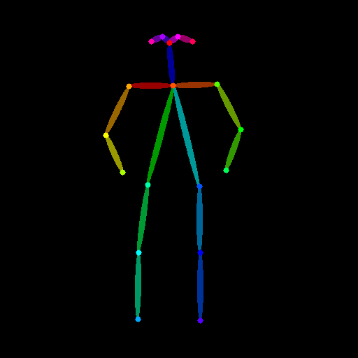
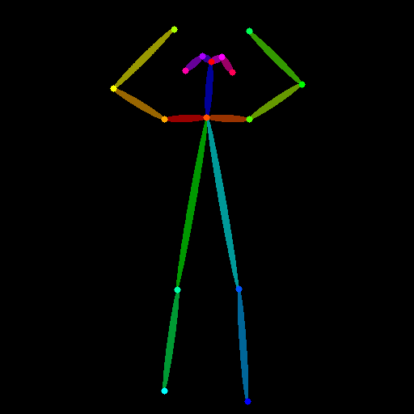
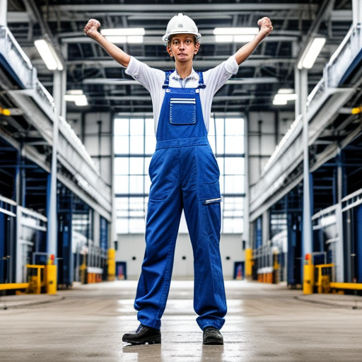

# 원하는 포즈로 이미지 만드는 도구

참조 사진 속 사람의 **자세(관절 위치)**를 OpenPose로 뽑아, 그 자세 그대로 **프롬프트가 묘사하는 새 인물**을 그리는 Colab 튜토리얼입니다.

```
참조 사진 → OpenPose 뼈대 추출 → 뼈대 + 프롬프트 → 같은 자세의 새 이미지
```

## 도구 설명
- 포즈 추출: `controlnet_aux` 의 OpenposeDetector
- 이미지 생성: Stable Diffusion 1.5 + ControlNet v1.1 OpenPose (`diffusers`)
- 실행 환경: Google Colab 무료 T4 GPU
- 출발점은 교안의 FLUX.2-klein 4B Colab 노트였지만, FLUX.2에는 공식 OpenPose ControlNet이 없어 무료 T4에서 안정적으로 동작하는 SD 1.5 조합으로 포즈 조건을 구현했습니다.

## 사용법
1. `pose_tool.ipynb` 를 Colab에서 엽니다. (GitHub에서 파일을 열고 Colab으로 열기, 또는 Colab의 파일 → 노트 업로드)
2. 런타임 → 런타임 유형 변경 → **T4 GPU** 를 선택합니다.
3. 위에서부터 셀을 차례로 실행하고, 셀 3에서 참조 사진 2장을 올립니다.
4. 결과는 `samples/` 에 저장되고, 마지막 셀에서 zip과 `prompts.md` 를 내려받습니다.

## 폴더 구조
```
pose-image-tool/
├── README.md        # 도구 설명, 사용법
├── pose_tool.ipynb  # Colab 튜토리얼 노트
├── samples/         # 참조 사진, 뼈대, 결과 이미지
└── prompts.md       # 테스트에 쓴 프롬프트
```

## 테스트 결과
| 참조 포즈 | 결과 |
|---|---|
|  |  |
|  |  |

- 포즈 1: ___ 자세 → 프롬프트: a factory worker in a white safety helmet → 결과: ___
- 포즈 2: ___ 자세 → 같은 프롬프트 → 결과: ___

## 한계
- ___ (예: 손이 작게 찍힌 사진에서는 손가락이 뭉개짐)

## 라이선스
- Stable Diffusion 1.5: CreativeML OpenRAIL-M
- ControlNet v1.1 OpenPose: OpenRAIL
